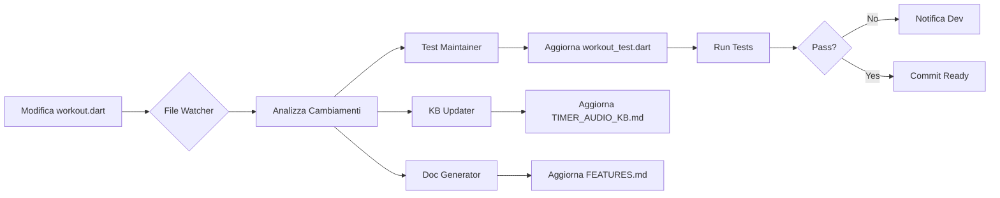

# 🤖 Sistema di Manutenzione Automatica GymBro

## 🎯 Obiettivo
Sistema proattivo che mantiene automaticamente:
- Test sincronizzati con il codice
- Knowledge Base aggiornata
- Documentazione marketing pronta
- Changelog dettagliato

## 🔄 Trigger Automatici

### 1. File Watcher (Tempo Reale)
```bash
# Monitora modifiche in tempo reale
fswatch -o lib/ test/ | xargs -n1 -I{} sh -c 'claude-code-agent maintain {}'
```

### 2. Git Hooks (Pre-Commit)
```bash
#!/bin/bash
# .git/hooks/pre-commit

# Analizza file modificati
CHANGED_FILES=$(git diff --cached --name-only)

for file in $CHANGED_FILES; do
  case "$file" in
    lib/*.dart)
      # Trigger agente test maintenance
      echo "🔧 Aggiornamento test per $file..."
      .claude/agents/test_maintainer.sh "$file"
      ;;
    test/*.dart)
      # Verifica coverage
      echo "📊 Verifica coverage..."
      .claude/agents/coverage_checker.sh "$file"
      ;;
  esac
done
```

## 📋 Agenti Specializzati

### 1. 🧪 TEST_MAINTAINER
**Trigger**: Modifica in `lib/`
**Azioni**:
```yaml
on_file_change:
  - Analizza modifiche nel file
  - Identifica metodi aggiunti/rimossi/modificati
  - Aggiorna test corrispondenti
  - Genera nuovi test per metodi nuovi
  - Rimuove test per metodi eliminati
  - Aggiorna mock se necessario
```

### 2. 📚 KB_UPDATER
**Trigger**: Modifica significativa
**Azioni**:
```yaml
on_significant_change:
  - Estrae pattern di soluzione
  - Documenta decisioni architetturali
  - Aggiorna best practices
  - Registra problemi risolti
  - Aggiorna dipendenze
```

### 3. 📱 APP_DESCRIPTOR
**Trigger**: Nuova feature completata
**Azioni**:
```yaml
on_feature_complete:
  - Aggiorna descrizione feature
  - Genera screenshot automatici
  - Crea copy marketing
  - Prepara changelog user-friendly
  - Aggiorna README
```

### 4. 🎬 DEMO_CREATOR
**Trigger**: Milestone raggiunta
**Azioni**:
```yaml
on_milestone:
  - Genera video demo
  - Crea GIF animate
  - Prepara pitch deck
  - Aggiorna landing page
```

## 🚀 Implementazione

### Setup Iniziale
```bash
#!/bin/bash
# setup_auto_maintenance.sh

# 1. Installa dipendenze
npm install -g fswatch
brew install watchman

# 2. Crea directory agenti
mkdir -p .claude/agents/scripts

# 3. Installa git hooks
cp .claude/agents/hooks/* .git/hooks/
chmod +x .git/hooks/*

# 4. Configura CI/CD
echo "Configurazione GitHub Actions..."
```

### File Watcher Service
```javascript
// .claude/agents/file_watcher.js
const chokidar = require('chokidar');
const { exec } = require('child_process');

const watcher = chokidar.watch('lib/**/*.dart', {
  persistent: true,
  ignoreInitial: true
});

watcher.on('change', async (path) => {
  console.log(`📝 File modificato: ${path}`);
  
  // Determina tipo di modifica
  const changeType = await analyzeChange(path);
  
  // Trigger agente appropriato
  switch(changeType) {
    case 'NEW_METHOD':
      await exec(`claude-code --agent test-creator --file ${path}`);
      break;
    case 'BREAKING_CHANGE':
      await exec(`claude-code --agent test-updater --file ${path}`);
      await exec(`claude-code --agent kb-updater --file ${path}`);
      break;
    case 'NEW_FEATURE':
      await exec(`claude-code --agent doc-generator --file ${path}`);
      break;
  }
});
```

## 📊 Dashboard Real-Time

### Status Monitor
```typescript
// .claude/agents/dashboard.tsx
interface MaintenanceStatus {
  testsInSync: boolean;
  coverage: number;
  kbLastUpdate: Date;
  pendingDocs: string[];
  marketingReady: boolean;
}

function MaintenanceDashboard() {
  return (
    <div>
      <h2>🤖 Auto-Maintenance Status</h2>
      <StatusIndicator label="Tests" status={testsInSync} />
      <CoverageBar percentage={coverage} />
      <KBStatus lastUpdate={kbLastUpdate} />
      <MarketingReadiness items={marketingAssets} />
    </div>
  );
}
```

## 🔔 Notifiche Intelligenti

### Slack Integration
```javascript
// Notifica quando serve intervento umano
async function notifyIfNeeded(event) {
  if (event.type === 'AMBIGUOUS_CHANGE') {
    await slack.send({
      channel: '#dev',
      text: `⚠️ Modifica ambigua in ${event.file}. Review richiesta.`,
      actions: [
        { text: 'Approva', action: 'approve' },
        { text: 'Modifica', action: 'modify' }
      ]
    });
  }
}
```

## 🎯 Workflow Esempio



## 🛠️ Comandi Quick

```bash
# Attiva monitoring automatico
make auto-maintain

# Status sistema
make maintenance-status

# Forza sync completo
make sync-all

# Genera marketing assets
make prepare-launch
```

## 📈 Metriche Tracciate

- **Test Coverage**: Target 80%
- **KB Updates**: Entro 24h da fix
- **Doc Freshness**: Max 7 giorni
- **Marketing Assets**: Ready per ogni release
- **Breaking Changes**: Documentati in 1h

## 🔐 Sicurezza

- Mai committare automaticamente
- Review umana per breaking changes
- Backup prima di modifiche massive
- Rollback automatico se test falliscono