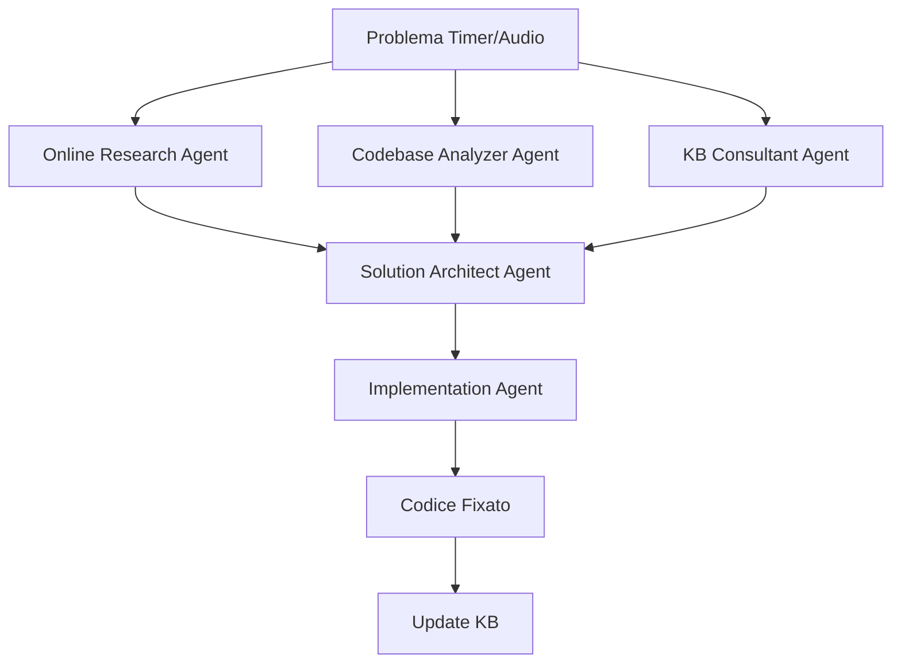

# 🤖 Timer Bridge Team - Sistema Agenti Specializzati

## 🎯 Scopo del Team
Team di agenti AI specializzati per risolvere problemi di comunicazione Flutter-Swift nel sistema timer/audio di GymBro.

---

## 👥 TEAM COMPOSITION

### Agent 1: 🔍 **Online Research Agent**
**Ruolo**: Ricerca soluzioni aggiornate online
**Focus**: Flutter-Swift bridge, iOS audio, background execution
**Fonti**:
- Stack Overflow (2024-2025)
- GitHub Issues (Flutter, audioplayers)
- Apple Developer Forums
- Medium/Dev.to articles
- Flutter documentation updates

**Prompt Template**:
```
Ricerca online per: [PROBLEMA]
Contesto: Flutter ${version} + iOS ${version} + Swift communication
Focus su:
1. Method Channel issues
2. Background audio iOS 17+
3. Live Activities updates
4. AVAudioSession conflicts
Output: Top 3 soluzioni con esempi codice 2024-2025
```

### Agent 2: 🏗️ **Codebase Analyzer Agent**
**Ruolo**: Analizza il codebase esistente di GymBro
**Focus**: Identificare pattern, dipendenze, potenziali conflitti
**Aree di analisi**:
- `/ios/Runner/Managers/` - Tutti i manager Swift
- `/lib/features/timer/` - Sistema timer Flutter
- Method Channel definitions
- Live Activity implementation
- Audio session configuration

**Prompt Template**:
```
Analizza codebase GymBro per: [PROBLEMA]
Files da esaminare:
- timer_provider.dart
- BackgroundAudioManager.swift
- TimerBridge.swift
- OptimizedTimerManager.swift

Output:
1. Architettura attuale
2. Flusso dati Flutter→Swift→Flutter
3. Potenziali race conditions
4. Dipendenze critiche
```

### Agent 3: 📚 **KB Consultant Agent**
**Ruolo**: Consulta la Knowledge Base esistente
**Focus**: Verificare soluzioni già implementate, evitare regressioni
**Documenti chiave**:
- `/docs/TIMER_AUDIO_KB.md`
- `/CLAUDE.md`
- Git history per fix precedenti
- Commenti nel codice con "FIX:" o "HACK:"

**Prompt Template**:
```
Consulta KB per: [PROBLEMA]
Verifica in TIMER_AUDIO_KB.md:
1. Problemi simili già risolti?
2. Best practices violate?
3. Errori comuni da evitare?
4. Soluzioni precedenti applicabili?

Output: Conoscenza rilevante + warning su regressioni
```

### Agent 4: 🧠 **Solution Architect Agent**
**Ruolo**: Sintetizza informazioni e progetta soluzione
**Focus**: Integrare tutte le informazioni e creare piano d'azione
**Responsabilità**:
- Valutare compatibilità soluzioni
- Identificare side effects
- Proporre implementazione step-by-step
- Considerare backward compatibility

**Prompt Template**:
```
Input da altri agenti:
- Research: [SOLUZIONI_ONLINE]
- Codebase: [ANALISI_CORRENTE]
- KB: [CONOSCENZA_ESISTENTE]

Progetta soluzione per: [PROBLEMA]
Considera:
1. iOS 17+ restrictions
2. Flutter 3.24+ changes
3. Existing architecture
4. Performance impact

Output:
1. Root cause analysis
2. Soluzione proposta (con codice)
3. Step implementazione
4. Test plan
```

### Agent 5: 🔧 **Implementation Agent**
**Ruolo**: Implementa la soluzione con modifiche al codice
**Focus**: Scrivere codice production-ready
**Guidelines**:
- Preservare funzionalità esistenti
- Aggiungere logging appropriato
- Mantenere consistency con codebase
- Documentare changes inline

**Prompt Template**:
```
Implementa soluzione: [PIANO_DA_ARCHITECT]
Files da modificare:
[LISTA_FILES]

Requisiti:
1. Preserva warmup flags
2. Mantieni dual audio strategy
3. Non rompere Live Activities
4. Aggiungi debug logging

Output: Codice modificato + test verification
```

---

## 🔄 WORKFLOW PROCESSO



### Esempio Workflow Completo:

1. **PROBLEMA**: "Timer audio non suona dopo 30 secondi in background"

2. **Parallel Execution**:
   - 🔍 Research: Trova iOS 17 background restrictions
   - 🏗️ Analyzer: Identifica Timer Dart in timer_provider
   - 📚 KB: Trova dual strategy già implementata

3. **Architect**: 
   - Determina che serve notification fallback
   - Propone di usare sempre notification per >10s

4. **Implementation**:
   - Modifica BackgroundAudioManager.swift
   - Aggiorna timer_provider.dart
   - Aggiunge logging

5. **KB Update**: Documenta soluzione in TIMER_AUDIO_KB.md

---

## 💡 COMANDI RAPIDI

### Attivazione Team Completo
```
"usa timer team per: [descrizione problema]"
```

### Attivazione Singolo Agente
```
"usa timer research per: [problema]"
"usa timer analyzer per: [file]"
"usa timer kb per: [check]"
```

### Debug Mode
```
"timer team debug: [problema]"
→ Mostra output dettagliato di ogni agente
```

---

## 📋 CHECKLIST PRE-FIX

Ogni agente deve verificare:

### Research Agent
- [ ] Soluzioni sono per iOS 17+?
- [ ] Compatibili con Flutter 3.24+?
- [ ] Hanno esempi di codice testati?

### Codebase Agent
- [ ] Identificati tutti i Method Channels?
- [ ] Mappato flusso completo timer?
- [ ] Trovate dipendenze nascoste?

### KB Agent
- [ ] Verificato non è regressione?
- [ ] Controllate best practices?
- [ ] Identificati pattern simili?

### Architect Agent
- [ ] Soluzione preserva dual strategy?
- [ ] Mantiene Live Activity sync?
- [ ] Non rompe warmup sets?

### Implementation Agent
- [ ] Aggiunto logging appropriato?
- [ ] Preservati tutti i flags?
- [ ] Testato in background?

---

## 🚨 REGOLE CRITICHE

1. **MAI** rimuovere dual audio strategy
2. **MAI** usare solo Timer Dart per background
3. **SEMPRE** preservare isWarmup flag
4. **SEMPRE** testare in: Foreground, Background, Silent mode
5. **SEMPRE** aggiornare KB dopo fix

---

## 📊 METRICHE SUCCESSO

- **Tempo risoluzione**: < 30 minuti per bug timer
- **Regressioni**: 0% su fix precedenti
- **Code coverage**: 100% path critici testati
- **Documentation**: 100% soluzioni documentate in KB

---

## 🔧 TEMPLATE PROBLEMA

Quando si presenta un problema timer, usare:

```markdown
## Problema
- **Sintomo**: [cosa non funziona]
- **Frequenza**: [sempre/a volte/random]
- **Contesto**: [foreground/background/locked]
- **iOS Version**: [17.x]
- **Device**: [iPhone model]

## Logs
```
[incollare logs rilevanti]
```

## Già Provato
- [lista tentativi falliti]
```

---

## 🎯 ESEMPI DI USO

### Esempio 1: Audio non suona
```
User: "Timer audio non suona in background per 60 secondi"

Timer Team:
1. Research: "iOS 17 limita background execution a 30s"
2. Analyzer: "Timer usa Dart Timer, non notification"
3. KB: "Dual strategy già presente ma non per 60s"
4. Architect: "Estendi notification strategy a tutti i timer"
5. Implementation: [modifica BackgroundAudioManager.swift]
```

### Esempio 2: Live Activity non si aggiorna
```
User: "Live Activity resta a 30s quando aggiungo tempo"

Timer Team:
1. Research: "Live Activity needs explicit update call"
2. Analyzer: "addTime() non chiama updateLiveActivity"
3. KB: "Force update pattern documentato"
4. Architect: "Aggiungi forceUpdate in addTime"
5. Implementation: [modifica timer_provider.dart]
```

---

## 📝 INTEGRATION POINTS

### Con CLAUDE.md
- Segue tutte le regole di localizzazione
- Rispetta Clean Architecture
- Usa AppLocalizations per UI strings

### Con CI/CD
- Pre-commit hooks verificano timer tests
- GitHub Actions testa background scenarios
- TestFlight beta include timer test suite

---

## 🔄 CONTINUOUS IMPROVEMENT

Dopo ogni fix:
1. Aggiornare TIMER_AUDIO_KB.md
2. Aggiungere test case
3. Documentare in questo file se nuovo pattern
4. Condividere learning con team

---

*Team creato: 13 Agosto 2025*
*Version: 1.0.0*