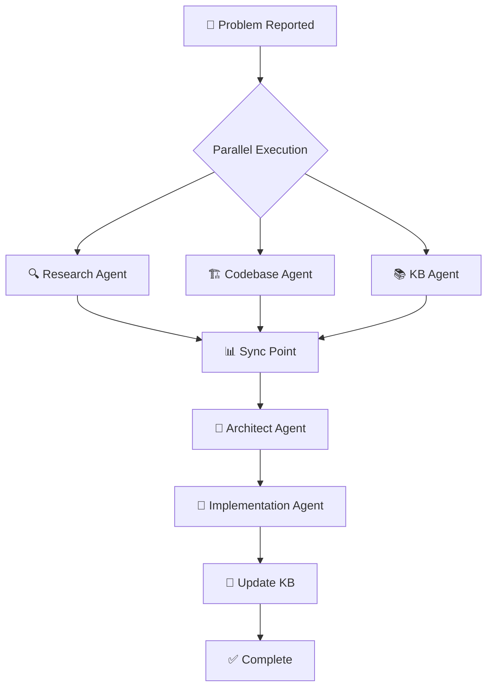

# 🎭 Timer Team Orchestrator

## Overview
Coordinates parallel execution of specialized agents for timer/audio issues.

## Agent Team
1. **🔍 Research** - Online solution discovery
2. **🏗️ Codebase** - Current implementation analysis  
3. **📚 KB** - Knowledge base consultation
4. **🧠 Architect** - Solution design
5. **🔧 Implementation** - Code execution

## Execution Flow



## Command Syntax

### Full Team Execution
```bash
# Run all agents for a problem
"timer team: [problem description]"

# Example
"timer team: audio not playing after 60 seconds in background"
```

### Parallel Phase Only
```bash
# Run only research phase (3 agents in parallel)
"timer team research: [problem]"
```

### Single Agent
```bash
# Run specific agent
"timer agent [name]: [task]"

# Examples
"timer agent research: iOS 17 background limits"
"timer agent kb: check dual audio strategy"
```

## Execution Template

```yaml
PROBLEM: [User provided description]
TIMESTAMP: [ISO 8601]
SESSION: [UUID]

PHASE 1: PARALLEL DISCOVERY (3 agents)
=====================================
Launching 3 agents in parallel...

[🔍 RESEARCH AGENT]
Status: Running...
Task: Search online for solutions

[🏗️ CODEBASE AGENT]
Status: Running...
Task: Analyze current implementation

[📚 KB AGENT]
Status: Running...
Task: Check knowledge base

⏱️ Waiting for agents to complete...

RESULTS:
-------
🔍 RESEARCH: 
   - Found 3 relevant solutions
   - iOS 17 requires notification for >30s
   - Swift forum confirms issue

🏗️ CODEBASE:
   - Timer uses Dart Timer
   - No notification fallback for 60s
   - Method channel exists at 'com.gymbro.timer/audio'

📚 KB:
   - Similar issue solved for 30s
   - Dual strategy documented
   - No 60s implementation yet

PHASE 2: SOLUTION DESIGN
========================
[🧠 ARCHITECT AGENT]
Status: Running...
Input: Results from 3 agents
Task: Design comprehensive solution

RESULT:
   - Extend notification to all timers >10s
   - Modify BackgroundAudioManager.swift
   - Update timer_provider.dart

PHASE 3: IMPLEMENTATION
=======================
[🔧 IMPLEMENTATION AGENT]
Status: Running...
Input: Architecture blueprint
Task: Modify code

CHANGES:
   ✅ BackgroundAudioManager.swift (line 27-35)
   ✅ timer_provider.dart (line 586-599)
   ✅ Added logging and error handling

PHASE 4: KNOWLEDGE UPDATE
=========================
📝 Updating TIMER_AUDIO_KB.md...
   - Added new problem/solution
   - Updated best practices
   - Added test cases

✅ TEAM EXECUTION COMPLETE
Time: 2.5 minutes
Files modified: 2
Tests required: Yes
```

## Color Coding for Terminal

When displaying in terminal, use these color codes:

```bash
# Agent Headers
🔍 RESEARCH AGENT     # Cyan
🏗️ CODEBASE AGENT    # Yellow  
📚 KB AGENT          # Magenta
🧠 ARCHITECT AGENT   # Green
🔧 IMPLEMENTATION    # Blue

# Status Indicators
⚡ Running...        # Yellow (active)
✅ Complete          # Green (success)
❌ Failed            # Red (error)
⏸️  Paused           # Gray (waiting)

# Output Sections
═══════════════      # White (phase separator)
-------              # Gray (subsection)
```

## Performance Metrics

### Target Times
- **Phase 1** (Parallel): 30-45 seconds
- **Phase 2** (Architect): 15-20 seconds  
- **Phase 3** (Implementation): 20-30 seconds
- **Phase 4** (KB Update): 5-10 seconds
- **Total**: < 2 minutes

### Parallelization Benefits
- 3x faster than sequential execution
- Better solution coverage
- No information bottlenecks
- Reduced cognitive load per agent

## Error Handling

### Agent Failure
```yaml
If Research Agent fails:
  - Continue with Codebase + KB
  - Architect works with partial data
  - Flag: "⚠️ Online research unavailable"

If Codebase Agent fails:
  - Continue with Research + KB
  - Request manual file inspection
  - Flag: "⚠️ Codebase analysis incomplete"

If KB Agent fails:
  - Continue with Research + Codebase
  - Extra caution for regressions
  - Flag: "⚠️ KB not consulted - check manually"
```

### Retry Logic
- Auto-retry failed agents once
- If still fails, continue with available data
- Document failures in output

## Usage Examples

### Example 1: Complete Fix
```bash
User: "timer team: live activity not updating when paused"

Output:
PHASE 1: PARALLEL DISCOVERY
🔍 RESEARCH: Found that Live Activities need explicit state updates
🏗️ CODEBASE: pauseTimer() doesn't call updateLiveActivity
📚 KB: Force update pattern exists for other states

PHASE 2: SOLUTION DESIGN
🧠 ARCHITECT: Add updateLiveActivityState call in pauseTimer

PHASE 3: IMPLEMENTATION
🔧 IMPLEMENTATION: Modified timer_provider.dart line 369-375

✅ Fixed in 1m 45s
```

### Example 2: Research Only
```bash
User: "timer team research: iOS 18 timer changes"

Output:
PHASE 1: PARALLEL DISCOVERY
🔍 RESEARCH: iOS 18 adds new BackgroundTasks API
🏗️ CODEBASE: Current implementation uses iOS 13+ API
📚 KB: No iOS 18 documentation yet

📊 Research complete - no implementation needed yet
```

## Integration Points

### With VS Code
```json
// .vscode/tasks.json
{
  "label": "Timer Team",
  "type": "shell",
  "command": "echo 'timer team: ${input:problem}'",
  "problemMatcher": []
}
```

### With Git Hooks
```bash
# .git/hooks/pre-commit
# Check if timer files modified
if git diff --cached --name-only | grep -q "timer\|audio"; then
  echo "⚠️ Timer files modified - consider running timer team"
fi
```

## Continuous Improvement

After each execution:
1. Measure actual vs target times
2. Identify bottlenecks
3. Update agent templates if needed
4. Add new patterns to KB
5. Share learnings in team notes

---

*Last Updated: August 2025*
*Version: 2.0.0*
*Parallel Execution Enabled*