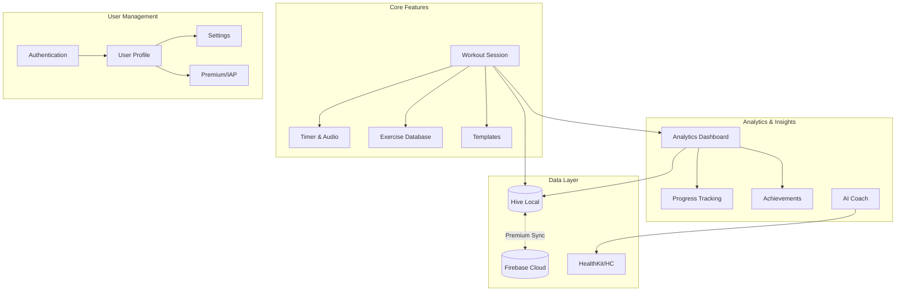
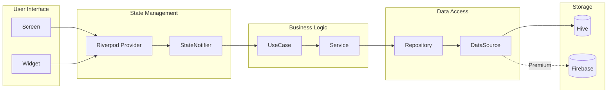
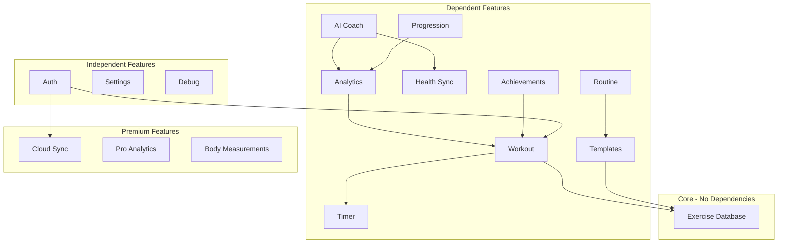

# FitLog Pro - System Architecture

> **Human-owned system map** - Last updated: 2025-12-13
> This document provides the high-level "helicopter view" of the entire system.

---

## Layer Architecture

```
┌─────────────────────────────────────────────────────────────────────────┐
│                         PRESENTATION LAYER                               │
│  ┌─────────────┐  ┌─────────────┐  ┌─────────────┐  ┌─────────────┐   │
│  │   Screens   │  │   Widgets   │  │  Providers  │  │   Modals    │   │
│  │ (GoRouter)  │  │ (Stateless) │  │ (Riverpod)  │  │  (Sheets)   │   │
│  └──────┬──────┘  └──────┬──────┘  └──────┬──────┘  └──────┬──────┘   │
├─────────┴────────────────┴────────────────┴────────────────┴───────────┤
│                          DOMAIN LAYER                                    │
│  ┌─────────────┐  ┌─────────────┐  ┌─────────────┐  ┌─────────────┐   │
│  │  Entities   │  │  UseCases   │  │  Services   │  │ Repository  │   │
│  │  (Freezed)  │  │   (Logic)   │  │  (Domain)   │  │ Interfaces  │   │
│  └──────┬──────┘  └──────┬──────┘  └──────┬──────┘  └──────┬──────┘   │
├─────────┴────────────────┴────────────────┴────────────────┴───────────┤
│                           DATA LAYER                                     │
│  ┌─────────────┐  ┌─────────────┐  ┌─────────────┐  ┌─────────────┐   │
│  │ Repository  │  │ DataSources │  │   Models    │  │  Services   │   │
│  │    Impl     │  │(Local/Cloud)│  │   (JSON)    │  │   (Data)    │   │
│  └──────┬──────┘  └──────┬──────┘  └──────┬──────┘  └──────┬──────┘   │
├─────────┴────────────────┴────────────────┴────────────────┴───────────┤
│                        INFRASTRUCTURE                                    │
│  ┌──────────────────┐  ┌──────────────────┐  ┌──────────────────┐     │
│  │    Hive (Local)  │  │ Firebase (Cloud) │  │   iOS Native     │     │
│  │   Always Active  │  │  Premium Only    │  │ (Live Activities)│     │
│  └──────────────────┘  └──────────────────┘  └──────────────────┘     │
└─────────────────────────────────────────────────────────────────────────┘
```

---

## Feature Map



---

## Data Flow



---

## Feature Dependencies



---

## Critical Paths

### 1. Workout Flow (Most Important)
```
Home → Start Workout → Add Exercise → Log Sets → Complete → Save
                ↓              ↓           ↓
           Timer Start    Exercise DB   Analytics Update
                ↓
        Live Activity (iOS)
```

### 2. Data Persistence Flow
```
User Action → Provider → Repository → Hive (immediate)
                                   ↓
                            Sync Queue (if premium)
                                   ↓
                            Firebase (async, 5min interval)
```

### 3. Exercise Database Flow
```
JSON Assets (base) → Hive Cache → User Patches → Merged Result
                          ↓
                   Firebase Sync (premium)
```

---

## Module Boundaries

| Module | Owns | Depends On |
|--------|------|------------|
| `core/` | Hive, Navigation, Config, Error Handling | - |
| `auth/` | User authentication, User model | `core/` |
| `workout/` | Workout entity, Sets, Exercises | `exercise_database/`, `timer/` |
| `exercise_database/` | Exercise entity, Search, Patches | `core/` |
| `timer/` | Timer logic, Audio, Live Activities | `core/` |
| `analytics/` | Stats, Charts, PR tracking | `workout/` |
| `ai_coach/` | Insights, Recommendations | `analytics/`, `health_sync/` |
| `premium/` | IAP, Entitlements | `auth/` |
| `routine/` | Routine scheduling, Templates | `workout/`, `templates/` |

---

## Key Architectural Decisions

See [`docs/ADR/`](docs/ADR/) for detailed Architecture Decision Records:

| ADR | Decision | Rationale |
|-----|----------|-----------|
| [001](docs/ADR/001-riverpod-over-bloc.md) | Riverpod over BLoC | Less boilerplate, better compile-time safety |
| [002](docs/ADR/002-hive-over-sqlite.md) | Hive over SQLite | Faster, no native code, great for Flutter |
| [003](docs/ADR/003-hybrid-sync.md) | Local-first + Cloud sync | 95% cost reduction, offline-first UX |
| [004](docs/ADR/004-freezed-entities.md) | Freezed for entities | Immutability, copyWith, JSON serialization |
| [005](docs/ADR/005-clean-architecture.md) | Clean Architecture | Testability, separation of concerns |

---

## Risk Areas / Complexity Hotspots

| Area | Risk Level | Why |
|------|------------|-----|
| `timer/` + iOS Live Activities | HIGH | Native Swift bridge, background audio, edge cases |
| `workout/` + Supersets/Dropsets | MEDIUM | Complex state, multiple exercise types |
| `exercise_database/` sync | MEDIUM | Patch conflicts, version management |
| `analytics/` calculations | LOW | CPU-intensive but well-isolated |
| `ai_coach/` | LOW | Feature-gated, isolated |

---

## Update This Document When

- [ ] Adding a new feature module
- [ ] Changing data flow patterns
- [ ] Adding new external integrations
- [ ] Modifying the sync architecture
- [ ] Adding new platform-specific code

---

*This is a human-owned document. AI can help update it, but humans must review and approve changes.*
