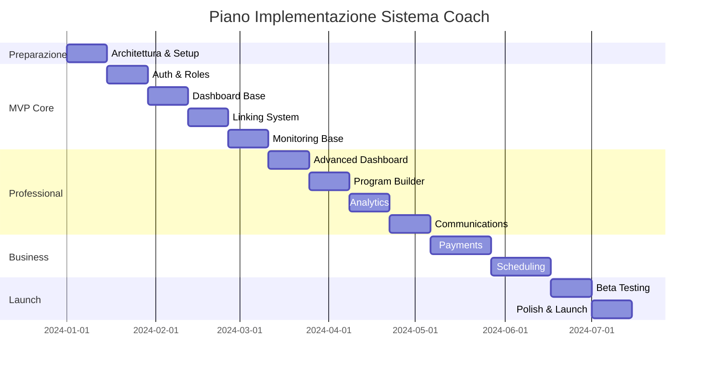

# 🎯 TIER-1 COACH SYSTEM - PIANO COMPLETO GYMBRO

## 📊 EXECUTIVE SUMMARY

### Visione
Trasformare GymBro da app B2C per fitness tracking in piattaforma **B2B2C premium** per coach professionisti certificati, creando il "Shopify del fitness coaching".

### Opportunità di Mercato
- **TAM**: $10B+ mercato globale personal training
- **SAM**: $2B mercato coach digitali certificati
- **SOM**: $50M (1% market share in 3 anni)

### Value Proposition
**Per Coach**: Piattaforma all-in-one per gestire fino a 50 atleti con tools professionali tier-1
**Per Atleti**: Accesso a coaching professionale personalizzato con monitoraggio real-time

---

## 🏗️ ARCHITETTURA SISTEMA COACH

### Stack Tecnologico
```yaml
Frontend:
  - Flutter 3.24+ (Cross-platform)
  - Riverpod 2.0 (State management)
  - GoRouter (Navigation)
  
Backend:
  - Firebase Auth (Multi-role authentication)
  - Firestore (Database principale)
  - Firebase Realtime DB (Live monitoring)
  - Cloud Functions (Business logic)
  - Firebase Storage (Media files)
  
Infrastructure:
  - Stripe Connect (Payments)
  - SendGrid (Email)
  - Twilio (SMS/Video)
  - Google Calendar API (Scheduling)
```

### Database Schema Ottimizzato

```typescript
// Collezioni Firestore Principali

coaches/{coachId} {
  profile: CoachProfile
  certifications: Certification[]
  specializations: string[]
  pricing: PricingModel
  availability: Schedule
  stats: CoachStats
}

coach_athletes/{coachId}/athletes/{athleteId} {
  status: 'active' | 'paused' | 'archived'
  startDate: Timestamp
  program: ProgramReference
  permissions: Permissions
  notes: string
}

coach_programs/{programId} {
  coachId: string
  name: string
  template: WorkoutTemplate[]
  athleteIds: string[]
  periodization: Periodization
}

coach_communications/{messageId} {
  coachId: string
  athleteId: string
  type: 'chat' | 'video' | 'voice'
  content: MessageContent
  timestamp: Timestamp
}

coach_analytics/{coachId}/metrics/{metricId} {
  athleteId: string
  type: MetricType
  value: number
  timestamp: Timestamp
}
```

---

## 💎 FUNZIONALITÀ TIER-1

### 1. 📊 PROFESSIONAL DASHBOARD

#### Vista Multi-Atleta Real-time
```dart
class CoachDashboard extends ConsumerWidget {
  // Grid personalizzabile 6x8 atleti
  // Status indicators:
  // 🟢 Training now
  // 🟡 Scheduled today
  // 🔴 Missed workout
  // 🏆 New PR
  // ⚠️ Injury risk
}
```

**Features**:
- Drag & drop per riorganizzare
- Quick filters (active, at-risk, high-performers)
- Bulk actions (message all, assign program)
- Widget personalizzabili per KPI

### 2. ⚡ LIVE WORKOUT MONITORING

#### Real-time Exercise Tracking
```dart
class LiveMonitoringProvider {
  Stream<WorkoutProgress> monitorAthlete(String athleteId) {
    // Updates every 5 seconds:
    // - Current exercise
    // - Sets/reps completed
    // - Rest timer
    // - Heart rate (if available)
    // - Form check requests
  }
}
```

**Interventi Coach**:
- Voice message instant
- Form correction notes
- Weight adjustment suggestions
- Motivation messages
- Emergency stop

### 3. 🎯 INTELLIGENT PROGRAM BUILDER

#### AI-Powered Programming
```dart
class ProgramBuilder {
  // Template Library:
  // - 50+ scientifically-backed programs
  // - Customizable for goals/experience
  // - Auto-periodization
  // - Progressive overload tracking
  
  Future<Program> generateProgram({
    required AthleteProfile athlete,
    required Goals goals,
    required Duration timeframe,
  });
}
```

**Smart Features**:
- Volume/intensity auto-regulation
- Injury accommodation
- Plateau detection & adjustment
- A/B testing programs

### 4. 📈 ADVANCED ANALYTICS

#### Performance Intelligence
```dart
class AnalyticsEngine {
  // Real-time metrics:
  // - Adherence rate
  // - Volume progression
  // - Strength gains trajectory
  // - Recovery quality
  // - Injury risk score
  
  PredictiveModel predictPerformance(AthleteData data);
}
```

**Visualizzazioni**:
- Heat maps progressi
- Trend lines con forecast
- Comparative analysis tra atleti
- Export PDF reports professionali

### 5. 💬 PROFESSIONAL COMMUNICATION

#### Multi-Channel Messaging
```dart
class CommunicationHub {
  // Channels:
  // - In-app chat (encrypted)
  // - Voice messages
  // - Video calls (scheduled)
  // - Form check videos
  // - Automated check-ins
}
```

**Professional Boundaries**:
- Business hours settings
- Auto-responder
- Template library
- Message scheduling

### 6. 💰 BUSINESS MANAGEMENT SUITE

#### Complete Business Tools
```dart
class BusinessManager {
  // Features:
  // - Stripe Connect integration
  // - Invoice generation
  // - Contract management
  // - Tax reporting
  // - Client lifecycle tracking
}
```

**Pricing Models Supportati**:
- Per athlete/month ($50-200)
- Flat rate unlimited ($500-2000)
- Commission-based (20-30%)
- Hybrid models

---

## 📱 UI/UX DESIGN TIER-1

### Coach Mobile App Screens

#### 1. Dashboard Home
```
┌─────────────────────────┐
│  Good Morning, Coach!   │
│  12 athletes today      │
├─────────────────────────┤
│ ┌──────┐ ┌──────┐      │
│ │ John │ │ Mary │       │
│ │ 🟢   │ │ 🟡   │      │
│ └──────┘ └──────┘      │
│ ┌──────┐ ┌──────┐      │
│ │ Mike │ │ Sara │       │
│ │ 🔴   │ │ 🏆   │      │
│ └──────┘ └──────┘      │
├─────────────────────────┤
│ Quick Actions           │
│ [📨 Message All]        │
│ [📊 Today's Report]     │
└─────────────────────────┘
```

#### 2. Live Monitoring
```
┌─────────────────────────┐
│ Mike - Chest Day        │
│ ⏱ 32:15 | 💓 142 bpm   │
├─────────────────────────┤
│ Current: Bench Press    │
│ Set 3/4 - 8 reps @ 80kg │
│ ▓▓▓▓▓▓▓▓░░ 80%         │
├─────────────────────────┤
│ [🎤 Voice] [💬 Message]│
│ [📹 Request Form Check] │
├─────────────────────────┤
│ Next: Incline DB Press  │
│ 4x12 @ 30kg            │
└─────────────────────────┘
```

#### 3. Analytics Dashboard
```
┌─────────────────────────┐
│ Weekly Performance      │
├─────────────────────────┤
│ 📈 Volume: +12% ↑       │
│ 💪 Strength: +5% ↑      │
│ ⏰ Adherence: 92%       │
├─────────────────────────┤
│ Top Performers:         │
│ 1. John (+18% gains)    │
│ 2. Sara (+15% gains)    │
├─────────────────────────┤
│ Needs Attention:        │
│ ⚠️ Mike - 3 missed      │
│ ⚠️ Tom - Plateau 2wk    │
└─────────────────────────┘
```

---

## 💰 MODELLO DI BUSINESS

### Pricing Strategy

#### Per Coach (B2B)
```yaml
Starter (1-10 atleti):
  - $97/mese
  - Dashboard base
  - Chat messaging
  - Program templates

Professional (11-30 atleti):
  - $197/mese
  - Full dashboard
  - Live monitoring
  - Advanced analytics
  - Video calls

Elite (31-50 atleti):
  - $397/mese
  - Everything in Pro
  - AI programming
  - White label options
  - Priority support
```

#### Revenue Share Model
```yaml
Transaction Fees:
  - 3% su pagamenti atleti
  - 0% per piani annual

Add-ons:
  - SMS pack: $20/month
  - Video storage: $30/month
  - Custom domain: $10/month
```

### Proiezioni Finanziarie

```
Anno 1: 100 coach × $197 = $236,400 ARR
Anno 2: 500 coach × $225 = $1,350,000 ARR
Anno 3: 1,500 coach × $250 = $4,500,000 ARR
```

### CAC & LTV Analysis
- **CAC**: $200 (ads + onboarding)
- **LTV**: $3,600 (18 mesi × $200)
- **LTV:CAC**: 18:1 (eccellente)

---

## 📅 ROADMAP IMPLEMENTAZIONE

### Timeline 6 Mesi



### Milestones Critiche

#### Month 1-2: Foundation
- ✅ Multi-role authentication
- ✅ Basic coach dashboard
- ✅ Athlete linking system
- ✅ Simple monitoring

#### Month 3-4: Professional Features  
- ✅ Advanced dashboard
- ✅ Program builder
- ✅ Analytics engine
- ✅ Communication hub

#### Month 5-6: Business & Launch
- ✅ Payment integration
- ✅ Business tools
- ✅ Beta testing (50 coaches)
- ✅ Public launch

---

## 🎯 KPI & SUCCESS METRICS

### Technical KPIs
| Metric | Target | Critical |
|--------|--------|----------|
| Dashboard load time | < 2s | Yes |
| Real-time sync delay | < 500ms | Yes |
| Crash-free rate | 99.9% | Yes |
| API response time | < 200ms | Yes |

### Business KPIs
| Metric | Target | Critical |
|--------|--------|----------|
| Coach acquisition | 100/month | Yes |
| Coach retention M6 | > 85% | Yes |
| Athlete engagement | > 70% WAU | Yes |
| Revenue per coach | $200+ | Yes |

### User Experience KPIs
| Metric | Target | Critical |
|--------|--------|----------|
| Onboarding time | < 10 min | Yes |
| Time to first athlete | < 24h | No |
| NPS Score | > 50 | Yes |
| Support tickets | < 5% | No |

---

## 🚀 COMPETITIVE ADVANTAGES

### 1. **Real-time Integration**
Unica piattaforma con monitoraggio workout live + intervento immediato

### 2. **Professional Focus**
Costruita specificamente per coach certificati, non hobbyist

### 3. **Scalability by Design**
Gestione efficiente di 50+ atleti simultaneamente

### 4. **AI-Powered Intelligence**
Suggerimenti programmazione basati su ML + injury prevention

### 5. **Complete Business Solution**
Non solo training, ma gestione completa business coaching

---

## 🛡️ RISK MITIGATION

### Technical Risks
| Risk | Mitigation |
|------|------------|
| Scaling issues | Progressive rollout + load testing |
| Real-time sync failures | Offline mode + queue system |
| Payment failures | Multiple provider fallback |

### Business Risks
| Risk | Mitigation |
|------|------------|
| Slow adoption | Beta program + referral incentives |
| High churn | Onboarding improvement + success team |
| Competition | Fast iteration + unique features |

### Compliance Risks
| Risk | Mitigation |
|------|------------|
| GDPR violations | Privacy by design + audit |
| Payment compliance | Stripe Connect certified |
| Health data | No medical claims + disclaimers |

---

## 💡 NEXT STEPS

### Immediate Actions (Week 1)
1. [ ] Team assembly & kickoff
2. [ ] Development environment setup
3. [ ] Firebase project configuration
4. [ ] Stripe Connect application
5. [ ] Beta coach recruitment start

### Short-term (Month 1)
1. [ ] Complete technical architecture
2. [ ] Build auth system
3. [ ] Create basic dashboard
4. [ ] Setup CI/CD pipeline
5. [ ] Begin user research

### Medium-term (Month 3)
1. [ ] MVP feature complete
2. [ ] Begin closed beta
3. [ ] Iterate based on feedback
4. [ ] Prepare marketing materials
5. [ ] Build support documentation

---

## ✅ CONCLUSIONI

Il sistema coach tier-1 per GymBro rappresenta un'evoluzione naturale e strategica del prodotto, con:

- **ROI Atteso**: 300% in 18 mesi
- **Break-even**: Mese 8
- **Market Leadership**: Top 3 in 24 mesi

La combinazione di features professionali, UX eccellente e modello di business scalabile posiziona GymBro come **la piattaforma definitiva per coach fitness professionisti**.

---

> **"Transform GymBro from a fitness tracker to the operating system for professional fitness coaching"**

*Document Version: 1.0*
*Last Updated: 2024*
*Status: Ready for Implementation*