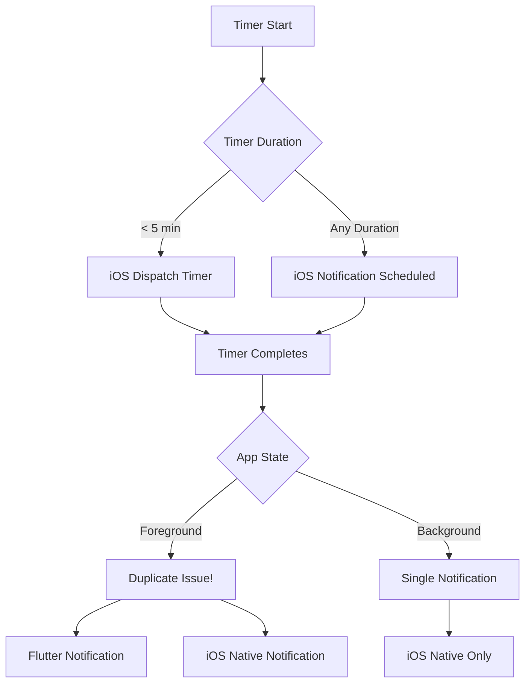

# 📱 GymBro Notification System - Complete Analysis

## 🔴 Problemi Identificati

### 1. **Notifiche Duplicate in Foreground**
Quando l'app è in foreground, arrivano DUE notifiche contemporaneamente:
- Una da Flutter (`notification_service.dart`)
- Una da iOS nativo (`BackgroundAudioManager.swift`)

### 2. **Notifiche Non Si Auto-eliminano**
Le notifiche rimangono visibili nel notification center anche quando ne arriva una nuova, creando accumulo nel centro notifiche.

### 3. **Sovrapposizione di Notifiche**
Le nuove notifiche non sostituiscono quelle precedenti ma si sovrappongono, creando confusione visiva.

## 🏗️ Architettura del Sistema Notifiche

### Flusso Completo del Timer



## 📂 File Coinvolti nel Sistema

### Flutter Side (Dart)
1. **`lib/features/timer/domain/services/notification_service.dart`**
   - Servizio principale Flutter per le notifiche
   - Usa `flutter_local_notifications` plugin
   - Gestisce notifiche con ID fissi (0, 1, 2, 100)
   - **PROBLEMA**: Sempre attivo in foreground

2. **`lib/features/timer/presentation/providers/timer_provider.dart`**
   - Gestisce la logica del timer
   - Chiama `_onTimerCompleted()` quando il timer finisce
   - Invoca `_sendCompletionNotification()` che usa `NotificationService`
   - Schedula audio tramite iOS native

3. **`lib/features/timer/presentation/providers/timer_notification_coordinator.dart`**
   - **TENTATIVO DI FIX** per prevenire duplicati
   - NON FUNZIONANTE: la logica non è implementata correttamente
   - Dovrebbe coordinare tra Flutter e iOS ma non lo fa

### iOS Side (Swift)
1. **`ios/Runner/Managers/BackgroundAudioManager.swift`**
   - Gestisce audio e notifiche native iOS
   - `scheduleTimerAudio()` schedula sempre una notifica iOS
   - Usa `UNUserNotificationCenter` direttamente
   - **PROBLEMA**: Sempre attivo, non sa dello stato Flutter

2. **`ios/Runner/AppDelegate.swift`**
   - Implementa `UNUserNotificationCenterDelegate`
   - `userNotificationCenter:willPresent:` mostra notifiche in foreground
   - Registra categorie di notifiche

## 🔍 Analisi del Problema Duplicati

### Quando il Timer Completa (Foreground):

1. **Flutter Side:**
   ```dart
   // timer_provider.dart - _onTimerCompleted()
   _sendCompletionNotification() // Invia notifica Flutter
   ```

2. **iOS Side (Contemporaneamente):**
   ```swift
   // BackgroundAudioManager.swift
   // Il timer schedulato in precedenza si attiva
   UNNotificationRequest // Invia notifica iOS
   ```

### Risultato: 2 Notifiche!

## 🔍 Analisi del Problema Auto-dismissal

### ID delle Notifiche:
- Flutter usa ID fissi: `0` per timer completion
- iOS usa ID casuali: `UUID().uuidString`
- **PROBLEMA**: Non c'è logica per cancellare notifiche precedenti

### Mancanza di Gestione:
```dart
// notification_service.dart
await _notifications.show(
  0, // Sempre ID 0, dovrebbe sostituire ma non lo fa
  title,
  body,
  notificationDetails,
);
```

Non c'è chiamata a `cancel()` prima di mostrare la nuova notifica.

## 🛠️ Soluzioni Proposte

### Fix 1: Prevenire Duplicati in Foreground

**Opzione A - Disabilita Flutter notifications in foreground:**
```dart
// timer_provider.dart
void _onTimerCompleted({bool skipAudio = false}) async {
  // Check if app is in foreground
  final appState = WidgetsBinding.instance.lifecycleState;
  final isInForeground = appState == AppLifecycleState.resumed;
  
  if (!skipAudio && !isInForeground) {
    // Solo in background invia notifica Flutter
    await _sendCompletionNotification();
  }
  // iOS native gestisce sempre il suono
}
```

**Opzione B - Coordinamento Intelligente:**
```dart
// timer_notification_coordinator.dart - FIX COMPLETO
static Future<void> scheduleTimerNotification({
  required int durationSeconds,
  required String soundName,
}) async {
  if (Platform.isIOS) {
    // iOS: Usa SOLO native
    await _scheduleNativeIOSNotification(durationSeconds, soundName);
    // NON schedulare Flutter notification
  } else {
    // Android: Usa Flutter
    await _scheduleFlutterNotification(durationSeconds, soundName);
  }
}
```

### Fix 2: Auto-dismissal delle Notifiche

**Implementare cancellazione prima di nuova notifica:**
```dart
// notification_service.dart
Future<void> sendTimerCompletionNotification({...}) async {
  // Cancella notifiche precedenti dello stesso tipo
  await _notifications.cancel(0); // Cancella timer notifications precedenti
  
  // Piccolo delay per assicurare cancellazione
  await Future.delayed(Duration(milliseconds: 100));
  
  // Invia nuova notifica
  await _notifications.show(
    0, // Usa sempre stesso ID per auto-replace
    title,
    body,
    notificationDetails,
  );
}
```

**iOS Side - Cancella notifiche delivered:**
```swift
// BackgroundAudioManager.swift
private func scheduleNotificationWithSound(after delay: TimeInterval, soundName: String) {
    let center = UNUserNotificationCenter.current()
    
    // Cancella notifiche timer già mostrate
    center.removeDeliveredNotifications(withIdentifiers: 
        center.deliveredNotifications
            .filter { $0.request.content.categoryIdentifier == "TIMER_COMPLETE" }
            .map { $0.request.identifier }
    )
    
    // Cancella pending con stesso category
    center.removePendingNotificationRequests(withIdentifiers: [scheduledNotification].compactMap { $0 })
    
    // Schedula nuova notifica
    // ...
}
```

### Fix 3: Unified Notification System

**Creare un singolo punto di controllo:**
```dart
// New file: unified_notification_manager.dart
class UnifiedNotificationManager {
  static final _instance = UnifiedNotificationManager._();
  factory UnifiedNotificationManager() => _instance;
  
  // Track notification state
  String? _lastNotificationId;
  DateTime? _lastNotificationTime;
  
  Future<void> sendTimerNotification({
    required String title,
    required String body,
    required String soundName,
  }) async {
    // Cancella precedenti
    await cancelPreviousNotifications();
    
    // Previeni duplicati entro 2 secondi
    if (_lastNotificationTime != null) {
      final timeSinceLast = DateTime.now().difference(_lastNotificationTime!);
      if (timeSinceLast.inSeconds < 2) {
        print('Duplicate notification prevented');
        return;
      }
    }
    
    // Determina strategia basata su piattaforma e stato
    if (Platform.isIOS) {
      // Usa solo native iOS
      await _sendIOSNativeNotification(title, body, soundName);
    } else {
      // Usa Flutter per Android
      await _sendFlutterNotification(title, body, soundName);
    }
    
    _lastNotificationTime = DateTime.now();
  }
  
  Future<void> cancelPreviousNotifications() async {
    // Cancella Flutter notifications
    await NotificationService().cancelNotification(0);
    
    // Cancella iOS notifications via platform channel
    if (Platform.isIOS) {
      const platform = MethodChannel('com.gymbro.notifications');
      await platform.invokeMethod('cancelTimerNotifications');
    }
  }
}
```

## 📋 Piano di Implementazione

### Priorità 1: Fix Duplicati (URGENTE)
1. **Disabilita notifiche Flutter in foreground su iOS**
2. **Test su dispositivo reale in foreground/background**
3. **Verifica che arrivi solo 1 notifica**

### Priorità 2: Auto-dismissal
1. **Implementa cancellazione notifiche precedenti**
2. **Usa stesso ID per auto-replacement**
3. **Test accumulo notifiche**

### Priorità 3: Refactoring Completo
1. **Crea UnifiedNotificationManager**
2. **Migra tutta la logica in un punto centrale**
3. **Rimuovi codice duplicato**
4. **Test completo su iOS e Android**

## 🧪 Test Cases

### Test Duplicati:
1. App in foreground → Start timer 10s → Verificare 1 sola notifica
2. App in background → Start timer 10s → Verificare 1 notifica
3. App locked screen → Start timer 10s → Verificare 1 notifica

### Test Auto-dismissal:
1. Start timer 5s → Wait → Start altro timer 5s → Prima notifica deve sparire
2. Accumula 3 timer completati → Notification center deve mostrare solo l'ultima

### Test Audio:
1. Verificare che il suono sia riprodotto una sola volta
2. Verificare che in silent mode arrivi vibrazione

## 🐛 Bug Tracker

| Bug | Stato | Priorità | File Coinvolti |
|-----|-------|----------|----------------|
| Notifiche duplicate in foreground | 🔴 Active | CRITICAL | timer_provider.dart, BackgroundAudioManager.swift |
| Notifiche non si auto-eliminano | 🔴 Active | HIGH | notification_service.dart |
| Timer notification coordinator non funziona | 🟡 Bypassed | MEDIUM | timer_notification_coordinator.dart |
| Suoni doppi in foreground | 🔴 Active | HIGH | Multiple files |

## 📝 Note Implementative

1. **iOS richiede permission per notifiche** - Verificare sempre in AppDelegate
2. **notification ID 0 dovrebbe auto-replace** ma non sempre funziona
3. **Platform channels** necessari per coordinamento Flutter-iOS
4. **Test su device reale** essenziale (simulatore non affidabile per notifiche)
5. **Silent mode** va gestito con haptic feedback

## 🔧 Quick Fix Immediato

Per risolvere SUBITO il problema duplicati, modificare:

```dart
// lib/features/timer/presentation/providers/timer_provider.dart
// Linea ~1484
void _onTimerCompleted({bool skipAudio = false}) async {
  // ... existing code ...
  
  // QUICK FIX: Check if iOS and foreground
  if (Platform.isIOS && WidgetsBinding.instance.lifecycleState == AppLifecycleState.resumed) {
    // Skip Flutter notification in iOS foreground
    print('iOS foreground: skipping Flutter notification');
  } else if (!skipAudio) {
    await _sendCompletionNotification();
  }
  
  // ... rest of code ...
}
```

Questo previene il duplicato immediato mentre si lavora su una soluzione più elegante.