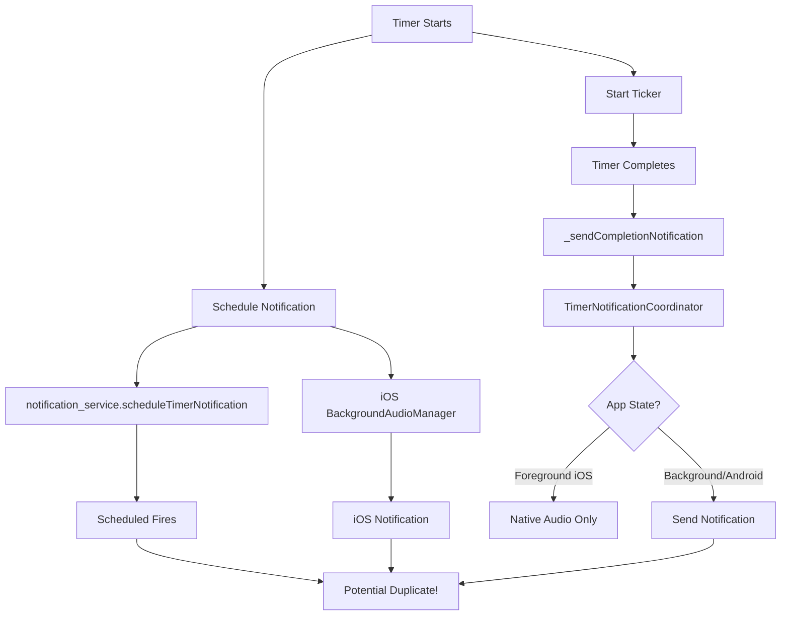

# 🔔 GymBro Notification System - Complete Knowledge Base

> **Last Updated**: 2025-08-22  
> **Version**: 1.0.0  
> **Status**: Tier-1 Documentation

## 📊 System Overview

The GymBro notification system has **multiple trigger points** and **fallback mechanisms** that can cause unexpected notifications. This document maps the entire system.

## 🎯 Notification Types

### 1. Timer Completion Notifications
- **Primary Text**: "Rest Complete! 💪" or "Exercise Complete! 🎉"
- **Trigger**: When timer reaches 0
- **IDs**: Flutter: `5000`, iOS: `"com.gymbro.timer.completion"`

### 2. Scheduled Timer Notifications
- **Text**: Same as timer completion
- **Trigger**: Scheduled for future (backup mechanism)
- **ID**: Flutter: `5002`

### 3. Workout Reminder Notifications
- **Text**: "Time to workout! 💪"
- **Trigger**: User-scheduled reminders
- **ID**: Flutter: `5001`

## 🗺️ Notification Flow Map



## 🔍 All Notification Trigger Points

### 1. **timer_provider.dart**
```dart
// Line 1114 - Scheduled notification when timer starts
await _notificationService?.scheduleTimerNotification(
  delay: Duration(seconds: durationSeconds),
  soundName: selectedSound,
);

// Line 1834 - Immediate notification on completion
await TimerNotificationCoordinator.sendTimerCompletionNotification(
  exerciseName: state!.exerciseName ?? 'Exercise',
  currentSet: state!.currentSet ?? 1,
  totalSets: state!.totalSets ?? 1,
);
```

### 2. **notification_service.dart**
```dart
// Line 176 - Timer completion notification
final title = currentSet < totalSets 
    ? 'Rest Complete! 💪'
    : 'Exercise Complete! 🎉';

// Line 257 - Scheduled timer notification
Future<void> scheduleTimerNotification({
  required Duration delay,
  String soundName = 'timer_complete',
})

// Line 343 - Scheduled notification content
final title = 'Rest Timer Complete';
final body = 'Time to start your next set!';
```

### 3. **BackgroundAudioManager.swift** (iOS)
```swift
// Line 94 - iOS scheduled notification
private func scheduleNotificationWithSound(after delay: TimeInterval, soundName: String) {
    content.title = "⏰ Rest Timer Complete"
    content.body = "Time to start your next set!"
}
```

### 4. **timer_notification_coordinator.dart**
```dart
// Line 55 - Coordinator notification text
final title = currentSet < totalSets 
    ? 'Rest Complete! 💪'
    : 'Exercise Complete! 🎉';
```

## 🐛 Known Issues & Causes

### Issue 1: "Exercise Complete" fires unexpectedly
**Causes**:
1. **Scheduled notification not cancelled** when timer is stopped/skipped
2. **Multiple scheduling** if timer is restarted
3. **Background fallback** firing even when not needed

### Issue 2: Duplicate notifications
**Causes**:
1. Both scheduled and immediate notifications fire
2. iOS and Flutter notifications both trigger
3. Deduplication window (2s) too short for scheduled notifications

### Issue 3: Wrong notification text
**Causes**:
1. Default fallback text when state is lost
2. Scheduled notification has different text than immediate

## 🛠️ Notification Decision Tree

```
Timer Starts
├── Schedule notification for T+duration
├── Start ticker
└── When completes:
    ├── Check if already notified (deduplication)
    ├── Check app state
    │   ├── iOS Foreground → Vibration only
    │   └── Background/Android → Send notification
    └── Cancel scheduled notification (MISSING!)
```

## 📍 Critical Code Locations

| File | Line | Purpose | Issue |
|------|------|---------|-------|
| timer_provider.dart | 1114 | Schedule notification | Not always cancelled |
| timer_provider.dart | 1834 | Send completion notification | Good - uses coordinator |
| notification_service.dart | 257 | Schedule timer notification | May conflict with immediate |
| notification_service.dart | 376 | Cancel scheduled notification | Not always called |
| BackgroundAudioManager.swift | 94 | iOS scheduled notification | Uses random ID (now fixed) |

## 🚨 Problem Areas

### 1. **Double Scheduling**
- Timer starts → Schedules notification
- Timer completes → Sends immediate notification
- **Result**: Both fire if scheduled not cancelled

### 2. **Missing Cancellation**
```dart
// When timer is stopped/skipped, need to:
await _notificationService?.cancelScheduledTimerNotification();
await TimerNotificationCoordinator.cancelTimerNotification();
```

### 3. **State Loss in Background**
- Scheduled notifications use generic text
- Should pass exercise info when scheduling

## ✅ Required Fixes for Tier-1

### Fix 1: Cancel scheduled when immediate fires ✅ IMPLEMENTED
```dart
// In _sendCompletionNotification (Line 1826-1828)
await _notificationService?.cancelScheduledTimerNotification(); 
await TimerNotificationCoordinator.cancelTimerNotification();
await TimerNotificationCoordinator.sendTimerCompletionNotification(...);
```

### Fix 2: Cancel all when timer stops ✅ IMPLEMENTED
```dart
// In stopTimer (Line 829-831)
await _notificationService?.cancelAllNotifications();
await TimerNotificationCoordinator.cancelAllNotifications();

// In skipTimer (Line 854-856)
await _notificationService?.cancelScheduledTimerNotification();
await TimerNotificationCoordinator.cancelTimerNotification();
```

### Fix 3: Unify notification text
```dart
// Use same text generator for all notifications
String getNotificationTitle(int currentSet, int totalSets) {
  return currentSet < totalSets 
    ? 'Rest Complete! 💪'
    : 'Exercise Complete! 🎉';
}
```

### Fix 4: Pass context to scheduled notifications
```dart
// When scheduling, include exercise info
await scheduleTimerNotification(
  delay: duration,
  exerciseName: state.exerciseName,
  currentSet: state.currentSet,
  totalSets: state.totalSets,
);
```

## 📋 Testing Checklist

- [ ] Start timer → Stop before completion → No notification
- [ ] Start timer → Skip → No notification  
- [ ] Start timer → Let complete → Exactly 1 notification
- [ ] Start timer → Background → Complete → Exactly 1 notification
- [ ] Start multiple timers quickly → Each replaces previous
- [ ] Timer in foreground iOS → Vibration only, no banner
- [ ] Timer in background → Notification with sound

## 🎯 Tier-1 Requirements

1. **Zero unexpected notifications**
2. **Exactly one notification per timer completion**
3. **Consistent messaging across all paths**
4. **Proper cleanup on all exit paths**
5. **State preserved in scheduled notifications**

## 📊 Notification ID Strategy

| ID | Type | Platform | Purpose |
|----|------|----------|---------|
| 5000 | Fixed | Flutter | Timer completion (auto-replace) |
| 5001 | Fixed | Flutter | Workout reminder |
| 5002 | Fixed | Flutter | Scheduled timer |
| "com.gymbro.timer.completion" | Fixed | iOS | All timer notifications |

## 🔄 State Machine

```
IDLE
  ↓ start
SCHEDULED (notification scheduled)
  ↓ tick
RUNNING
  ↓ complete
NOTIFYING (cancel scheduled, send immediate)
  ↓
COMPLETED
```

## 🚀 Implementation Priority

1. **HIGH**: Fix scheduled notification cancellation
2. **HIGH**: Unify notification text
3. **MEDIUM**: Add context to scheduled notifications
4. **LOW**: Extend deduplication window
5. **LOW**: Add notification analytics

## 📝 Maintenance Notes

- Always test notification changes on real devices
- iOS simulator doesn't properly simulate background behavior
- Android emulator works fine for notification testing
- Use `flutter logs` to monitor notification events

---

**KB Version**: 1.0.0  
**Maintained by**: Claude + Michele  
**Review Schedule**: After each notification-related change