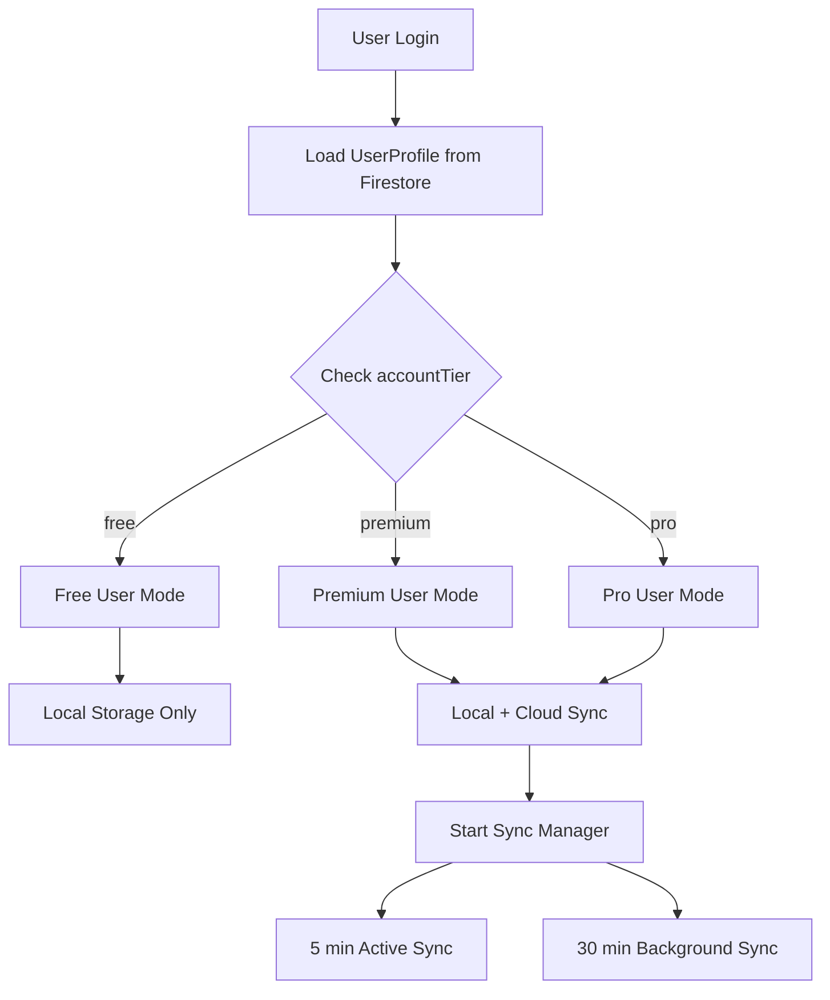

# 🎯 Sistema di Rilevamento Utenti Premium - Documentazione Completa

## 📋 Indice
1. [Come Funziona](#come-funziona)
2. [Flusso di Rilevamento](#flusso-di-rilevamento)
3. [Implementazione Tecnica](#implementazione-tecnica)
4. [Gestione degli Stati](#gestione-degli-stati)
5. [Sicurezza](#sicurezza)
6. [Test e Debug](#test-e-debug)

---

## 🔍 Come Funziona

Il sistema rileva automaticamente se un utente è Premium attraverso un processo multi-livello:

### 1. **UserProfile Entity**
```dart
enum AccountTier {
  free,     // Utente gratuito
  premium,  // Utente premium (sync attivo)
  pro,      // Utente pro (tutte le feature + priorità)
}
```

### 2. **Fonte della Verità: Firestore**
Il profilo utente è salvato in Firestore con il campo `accountTier`:

```javascript
// Firestore Document: /users/{userId}
{
  "uid": "user_123",
  "email": "user@example.com",
  "displayName": "Mario Rossi",
  "accountTier": "premium",  // <-- QUESTO DETERMINA IL TIER
  "createdAt": "2024-01-01T00:00:00Z",
  "lastLoginAt": "2024-01-15T10:30:00Z",
  "templateQuota": {
    "maxPrivateTemplates": 50,
    "maxPublicTemplates": 10
  }
}
```

---

## 🔄 Flusso di Rilevamento



### Processo Step-by-Step:

#### 1️⃣ **Login/App Start**
```dart
// In AuthProvider
Future<void> signIn() async {
  // 1. Authenticate with Firebase
  final credential = await FirebaseAuth.instance.signIn(...);
  
  // 2. Load user profile from Firestore
  final doc = await FirebaseFirestore.instance
      .collection('users')
      .doc(credential.user.uid)
      .get();
  
  // 3. Parse UserProfile with tier
  final userProfile = UserProfile.fromFirestore(doc);
  
  // 4. Store in state
  state = AsyncValue.data(userProfile);
}
```

#### 2️⃣ **BaseHybridRepository Check**
```dart
class BaseHybridRepository<T> {
  UserProfile? _userProfile;
  Timer? _profileRefreshTimer;
  
  // Load profile on initialization
  Future<void> _loadUserProfile() async {
    final user = _auth.currentUser;
    if (user != null) {
      final doc = await _firestore
          .collection('users')
          .doc(user.uid)
          .get();
      
      if (doc.exists) {
        _userProfile = UserProfile.fromFirestore(doc);
      }
    }
  }
  
  // Check premium status
  bool get isPremiumUser {
    return _userProfile?.accountTier == AccountTier.premium ||
           _userProfile?.accountTier == AccountTier.pro;
  }
  
  // Check if can sync
  bool get canSyncToCloud {
    if (!requiresPremiumForCloud) return true;
    return isPremiumUser;
  }
}
```

#### 3️⃣ **Refresh Timer (ogni 5 minuti)**
```dart
void _startProfileMonitoring() {
  _profileRefreshTimer = Timer.periodic(Duration(minutes: 5), (_) {
    _loadUserProfile(); // Ricarica profilo da Firestore
  });
}
```

---

## 💻 Implementazione Tecnica

### Repository Example
```dart
class WorkoutRepository extends BaseHybridRepository<Workout> {
  Future<void> saveWorkout(Workout workout) async {
    // 1. SEMPRE salva in locale
    await saveLocally(workout);
    
    // 2. Check se premium
    if (isPremiumUser) {  // <-- Controlla accountTier
      // 3. Aggiungi a coda sync
      await queueForSync(workout);
      
      // 4. Avvia sync in background
      scheduleSyncTask();
    }
  }
}
```

### Provider Integration
```dart
final userTierProvider = Provider<AccountTier>((ref) {
  final user = ref.watch(currentUserProvider).value;
  return user?.accountTier ?? AccountTier.free;
});

final canSyncProvider = Provider<bool>((ref) {
  final tier = ref.watch(userTierProvider);
  return tier == AccountTier.premium || tier == AccountTier.pro;
});
```

---

## 🔄 Gestione degli Stati

### Cambio di Tier (Free → Premium)

```dart
// Quando l'utente fa upgrade
Future<void> upgradeUserToPremium(String userId) async {
  // 1. Update Firestore
  await FirebaseFirestore.instance
      .collection('users')
      .doc(userId)
      .update({
        'accountTier': 'premium',
        'upgradedAt': FieldValue.serverTimestamp(),
      });
  
  // 2. Reload profile locally
  await _loadUserProfile();
  
  // 3. Start syncing existing local data
  if (isPremiumUser) {
    await processSyncQueue();
    startPremiumSync();
  }
}
```

### Downgrade (Premium → Free)
```dart
Future<void> downgradeUserToFree(String userId) async {
  // 1. Stop sync
  stopPremiumSync();
  
  // 2. Update Firestore
  await FirebaseFirestore.instance
      .collection('users')
      .doc(userId)
      .update({
        'accountTier': 'free',
        'downgradedAt': FieldValue.serverTimestamp(),
      });
  
  // 3. Keep local data (no deletion!)
  // User keeps all data locally
}
```

---

## 🔒 Sicurezza

### Firestore Security Rules
```javascript
// Solo l'utente può leggere il proprio profilo
match /users/{userId} {
  allow read: if request.auth != null && request.auth.uid == userId;
  
  // Solo admin può modificare accountTier
  allow update: if request.auth != null && 
    (request.auth.uid == userId && 
     !request.resource.data.diff(resource.data).affectedKeys()
       .hasAny(['accountTier'])) ||
    isAdmin(request.auth.uid);
}

// Sync solo per premium
match /workouts/{workoutId} {
  allow read, write: if request.auth != null && 
    request.auth.uid == resource.data.userId &&
    isPremiumUser(request.auth.uid);
}

function isPremiumUser(userId) {
  let user = get(/databases/$(database)/documents/users/$(userId));
  return user.data.accountTier in ['premium', 'pro'];
}
```

### Client-Side Validation
```dart
// Double-check before sync
Future<bool> validatePremiumStatus() async {
  try {
    // Re-fetch profile from Firestore
    final doc = await _firestore
        .collection('users')
        .doc(currentUserId)
        .get();
    
    final profile = UserProfile.fromFirestore(doc);
    
    // Update cached profile
    _userProfile = profile;
    
    // Return current status
    return profile.accountTier == AccountTier.premium ||
           profile.accountTier == AccountTier.pro;
  } catch (e) {
    // On error, assume free
    return false;
  }
}
```

---

## 🧪 Test e Debug

### Test Premium Detection
```dart
test('should detect premium user correctly', () async {
  // Mock Firestore response
  when(mockFirestore.collection('users').doc('test_user').get())
    .thenAnswer((_) async => MockDocumentSnapshot({
      'uid': 'test_user',
      'accountTier': 'premium',
      // ... other fields
    }));
  
  // Create repository
  final repo = TestRepository(firestore: mockFirestore);
  
  // Load profile
  await repo.initialize();
  
  // Verify
  expect(repo.isPremiumUser, true);
  expect(repo.canSyncToCloud, true);
});
```

### Debug Commands
```dart
// Check current tier in console
void debugPremiumStatus() {
  print('User ID: ${_auth.currentUser?.uid}');
  print('Account Tier: ${_userProfile?.accountTier}');
  print('Is Premium: $isPremiumUser');
  print('Can Sync: $canSyncToCloud');
  print('Profile Last Updated: ${_userProfile?.lastLoginAt}');
}
```

### Admin Dashboard Query
```dart
// Get all premium users
Stream<List<UserProfile>> getPremiumUsers() {
  return _firestore
      .collection('users')
      .where('accountTier', whereIn: ['premium', 'pro'])
      .snapshots()
      .map((snapshot) => snapshot.docs
          .map((doc) => UserProfile.fromFirestore(doc))
          .toList());
}
```

---

## 📊 Monitoring Premium Status

### Analytics Events
```dart
void trackPremiumEvent(String event) {
  analytics.logEvent(
    name: 'premium_activity',
    parameters: {
      'user_id': currentUserId,
      'tier': _userProfile?.accountTier.name,
      'event': event,
      'timestamp': DateTime.now().toIso8601String(),
    },
  );
}
```

### Dashboard Metrics
```dart
Future<Map<String, int>> getPremiumMetrics() async {
  final users = await _firestore.collection('users').get();
  
  int free = 0, premium = 0, pro = 0;
  
  for (final doc in users.docs) {
    final tier = doc.data()['accountTier'] ?? 'free';
    switch (tier) {
      case 'free': free++; break;
      case 'premium': premium++; break;
      case 'pro': pro++; break;
    }
  }
  
  return {
    'free': free,
    'premium': premium,
    'pro': pro,
    'conversion_rate': (premium + pro) / users.size * 100,
  };
}
```

---

## 🔄 Flow Diagram Completo

```
┌─────────────────────────────────────────────────────────┐
│                      APP START                          │
└────────────────────────┬────────────────────────────────┘
                         ▼
                ┌────────────────┐
                │ Firebase Auth  │
                └────────┬───────┘
                         ▼
            ┌────────────────────────┐
            │ Load UserProfile from  │
            │     Firestore          │
            └────────────┬───────────┘
                         ▼
              ┌──────────────────┐
              │ Check accountTier │
              └────────┬─────────┘
                       ▼
        ┌──────────────┴──────────────┐
        ▼                             ▼
   ┌─────────┐                  ┌──────────┐
   │  FREE   │                  │ PREMIUM  │
   └────┬────┘                  └────┬─────┘
        ▼                             ▼
┌───────────────┐           ┌─────────────────┐
│ Local Storage │           │ Local Storage + │
│     Only      │           │   Cloud Sync    │
└───────────────┘           └─────────────────┘
                                     ▼
                            ┌─────────────────┐
                            │ Sync Manager    │
                            │ - 5 min active  │
                            │ - 30 min bg     │
                            └─────────────────┘
```

---

## ❓ FAQ

### Q: Dove viene salvato l'accountTier?
**A:** In Firestore, documento `/users/{userId}`, campo `accountTier`

### Q: Ogni quanto viene controllato?
**A:** 
- All'avvio app
- Ogni 5 minuti (timer automatico)
- Prima di ogni operazione di sync

### Q: Cosa succede se Firestore è offline?
**A:** Usa l'ultimo stato cached. Free per default se non c'è cache.

### Q: Come testare in development?
**A:** Modifica manualmente il documento Firestore del tuo utente test:
```javascript
// Firebase Console → Firestore → users → {yourUserId}
{
  "accountTier": "premium"  // Cambia questo campo
}
```

### Q: Il premium è real-time?
**A:** Quasi. Max 5 minuti di delay dal cambio su Firestore.

---

## 🚀 Quick Start per Testing

```dart
// 1. Get current user tier
final tier = ref.read(userTierProvider);
print('Current tier: $tier');

// 2. Force refresh
await ref.read(currentUserProvider.notifier).refreshProfile();

// 3. Check sync capability
final canSync = ref.read(canSyncProvider);
print('Can sync: $canSync');

// 4. Manually trigger sync (if premium)
if (canSync) {
  await ref.read(syncManagerProvider).syncNow();
}
```

---

*Ultimo aggiornamento: 2025*
*Versione: 1.0.0*